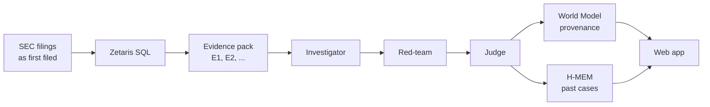

# Veritas

**Does management's growth story match the numbers?**

*Open Agent Hackathon 2026 · Track 02: The Agent That Can Explain Why. Built for investors, auditors and journalists, on real, public SEC filings.*

Every 10-K explains why revenue grew. Veritas checks that explanation against the numbers the company first filed with the SEC, and shows:

- which explanations the numbers back up, contradict, or leave unverified
- the evidence behind every statement, down to the SQL row and the filing
- the questions an analyst should ask management

A mismatch is a reason to ask questions, not proof of wrongdoing.

## Quick start

Needs Node.js 26+. No API key needed for the recorded demo.

```bash
npm install
npm run setup
npm start
```

Open http://localhost:8788. You get 11 recorded cases, each run 3 times. The header has a light/dark theme toggle.

**No install:** a read-only copy of the recorded demo is at https://manishmodak.github.io/veritas/. Live runs, feedback and search show a "run it locally" note there. To build your own copy for any static host, run `npm run export:static`: it writes `site/` (about 5 MB), from Zetaris when `ZETARIS_BRIDGE_URL` is set, otherwise from the CSVs.

## Check any 10-K filer

Type a ticker (or CIK) and the year its fiscal year ended, e.g. `NVDA` and `2025`. It works for companies that file an original 10-K with XBRL financial data, for fiscal years from 2010 on, with the year before also filed (Veritas compares two years). Veritas:

1. fetches that 10-K's MD&A and the as-first-filed XBRL facts for that year and the year before, straight from SEC EDGAR ([`data/add_company.py`](data/add_company.py));
2. loads them into Zetaris (or the CSV store) and builds the evidence pack;
3. shows the numbers and quarter pattern right away. "Run live" then runs the debate through Meterless Nightshift (see [Live runs](#live-runs-through-meterless-nightshift)).

Takes 10–60 seconds. Added companies persist across restarts and appear at the top of the cohort, outside the benchmark counts.

## How it works



1. **Evidence.** Zetaris SQL pulls the first-filed revenue, receivables and cash flow, the quarterly figures and the MD&A text. Each item gets an ID (`E30`).
2. **Investigator.** Lists what management says drove growth, checks each claim against the numbers and writes questions for management.
3. **Red-team.** Argues the strongest innocent explanation for each finding.
4. **Judge.** Rules on each finding and cites the evidence that decides it.
5. **Three runs.** The whole debate runs 3 times, in parallel (a live check takes a few minutes). The app shows agreement ("2 of 3 runs"), not one confident label.

All three roles run on NVIDIA Nemotron 3 Ultra, served through Meterless Nightshift. Every citation is checked against the evidence pack, and every step (Zetaris queries, H-MEM recall, each model request with the model that handled it, World Model ingest) is logged ([`logs/agent-trace.jsonl`](logs/agent-trace.jsonl)).

## Results

11 company-years. 3 were used to tune the prompts (dev); the other 8 were run blind after the prompts were frozen.

| | Result |
| --- | --- |
| Model calls | 99, with 0 citations to IDs outside the pack |
| Blind SEC-case years | Investigator said "does not fit" on 2 of 4 |
| Blind peers (no SEC case) | Investigator said "does not fit" on 0 of 4 |
| Judge | Mostly "unverified" |

The sample is small and hand-picked, so this is not an accuracy rate.

### Hero case: Under Armour FY2015

- The overall label is "fits" (3 of 3 runs). The agent does not call this a fraud.
- It does find the odd spot: **Q4 receivables grew 55% while revenue grew 31%**, and days sales outstanding rose from 28 to 34 (`E30`).
- All 3 runs ask management about Q4 shipment timing. One asks how much Q4 2015 revenue came from shipments **pulled forward from Q1 2016**.
- In 2021 the [SEC charged Under Armour](https://www.sec.gov/newsroom/press-releases/2021-78) for not disclosing that pulled-forward sales were propping up its growth. The agent never sees the SEC action.

### Disguised controls

Does the model just recognise companies with a later scandal? We reran the two blind hits in disguise, twice:

- **Names masked:** company and product names replaced ("the Company", "Product A").
- **Names, years and amounts:** names masked, every year moved 7 years later, every dollar amount scaled by 1.37. Ratios, growth rates and days are unchanged, so the evidence means the same thing.

| Case | Investigator, named | Names masked | Names, years, amounts |
| --- | --- | --- | --- |
| MiMedx FY2015 | does not fit 3/3 | does not fit 3/3 | does not fit 3/3 |
| Super Micro FY2015 | does not fit 2/3 | does not fit 3/3 | does not fit 2/3 |
| Nike FY2015 (peer, control) | fits 3/3 | — | unverified 2/3, fits 1/3 |

The verdicts held. The Nike control shows the disguise makes the model more cautious but does not invent a mismatch. Every run cited only in-pack IDs. Scripts: [`agent/anon_control.py`](agent/anon_control.py), [`agent/shifted_control.py`](agent/shifted_control.py); results and judge verdicts: [`runs/anon/`](runs/anon/).

### Labels drift between runs

A new live 3-run Super Micro FY2015 analysis said "fits" 2 of 3 times; the recorded one said "does not fit" 2 of 3. That is why the app leads with findings and questions, and shows labels only as agreement.

## Sponsor technology

### Zetaris: one SQL layer over every source

- With a bridge URL set, every data query runs as SQL through Zetaris ([`queries.ts`](app/src/data/queries.ts), [`zetaris.ts`](app/src/data/zetaris.ts)). Without one, the same queries run on the bundled CSVs.
- Five tables (facts, quarters, beneish, mdna_index, mdna_paragraphs) live in Postgres, registered in Zetaris as a JDBC datasource.
- The cohort's industry names come from a **live REST API** (company_dns), joined to the Postgres data in one Zetaris query:

```sql
SELECT b.*, s.name AS industry
FROM veritas_pg.beneish b
LEFT JOIN company_dns.sic_names s ON b.sic = s.code
```

- Every evidence item shows the SQL Zetaris ran and the rows it used.

### Meterless: provenance and memory

- **World Model** ([`world.ts`](app/src/memory/world.ts)) links company → filing → evidence → finding → ruling. Click any evidence ID to see that chain, its SQL and its audit history.
- **H-MEM** ([`cases.ts`](app/src/memory/cases.ts)) recalls similar past cases and stores analyst feedback. It only recalls cases **filed before** the current one, so later filings can't leak in.
- Engines are vendored unchanged under Apache-2.0 ([attribution](app/vendor/README.md)).

### Meterless Nightshift: the AI provider

- Every live model request goes to the Nightshift Runtime (`POST {METERLESS_BASE_URL}/chat/completions`, with the Console API key as `Authorization: Bearer` and the `meterless-app: veritas` and `meterless-scope: user` headers) ([`nim.ts`](app/src/agent/nim.ts)). Nightshift calls NVIDIA with the key stored in its Providers tab, so Veritas never holds an NVIDIA key.
- Veritas pins the route to `nvidia/nemotron-3-ultra-550b-a55b` and records the model Nightshift reports for each answer (`meterless.routed_model`) plus its receipt ID, in the saved run (`calls`) and in [`logs/agent-trace.jsonl`](logs/agent-trace.jsonl).
- Direct NVIDIA NIM (`NVIDIA_API_KEY`) remains only as a fallback when `METERLESS_BASE_URL` is unset.

### NVIDIA Nemotron

- `nvidia/nemotron-3-ultra-550b-a55b`, reached through Nightshift's NVIDIA provider, plays investigator, red-team and judge.
- Temperature 0.3, up to 16,000 tokens, 3 attempts per call. The model's reasoning text (Nightshift returns it before `</think>`) is dropped and never saved or used as evidence.

### What is different

- **As-first-filed numbers.** Later restatements are ignored, so the agent sees only what investors saw at the time.
- **Inspectable evidence.** Every claim cites an ID that opens its SQL, rows and filing.
- **No hindsight.** Memory only recalls earlier filings; the SEC outcome is never in the pack.
- **Agreement, not one label.** Each case runs 3 times and shows how often the runs agree.

Cursor was not used.

## Configuration

All settings are environment variables; [`.env.example`](.env.example) lists them with placeholders.

| Setting | Effect |
| --- | --- |
| `ZETARIS_BRIDGE_URL=http://localhost:8787` | Use Zetaris instead of the bundled CSVs |
| `ZETARIS_SCHEMA` | Zetaris schema for the five tables (default `veritas_pg`) |
| `FACTS_SOURCE=csv` or `zetaris` | Force a data source |
| `SAMPLE_MODE=false` + `METERLESS_BASE_URL` + `METERLESS_RUNTIME_TOKEN` | Enable live runs through Meterless Nightshift (3 runs = 9 model calls) |
| `METERLESS_MODEL` | Nightshift route to request (default `nvidia/nemotron-3-ultra-550b-a55b`) |
| `NVIDIA_API_KEY` | Fallback only: call NVIDIA NIM directly when `METERLESS_BASE_URL` is unset |
| `PORT` | Server port (default 8788) |
| `VERITAS_STATE_DIR` | Where live results and memory are saved (default `app/.state`) |

Zetaris errors fail loudly; the app never falls back to CSV silently. One case from the command line: `npm run live -- CIK YYYY-MM-DD [samples=1]`.

## Live runs through Meterless Nightshift

The recorded demo needs none of this. For live runs ([Participant Setup Guide](https://hackathon.genai.works/resources), section 4):

1. Install Nightshift from [meterless.ai](https://meterless.ai/#download) (Mac M1+, Windows or DGX edition) and leave it running.
2. In Nightshift, **Setup → Providers → NVIDIA**: paste your NVIDIA API key ([build.nvidia.com](https://build.nvidia.com)) and save.
3. Open **Console** (top right) and copy the Runtime URL and API key.
4. Start Veritas with them:

```bash
export SAMPLE_MODE=false
export METERLESS_BASE_URL=http://127.0.0.1:8088/v1      # the Console URL
export METERLESS_RUNTIME_TOKEN=<Nightshift Console API key>
npm start
```

Check the connection first with `curl -s $METERLESS_BASE_URL/chat/completions -H "Authorization: Bearer $METERLESS_RUNTIME_TOKEN" -H "content-type: application/json" -H "meterless-app: veritas" -H "meterless-scope: user" -d '{"model":"nvidia/nemotron-3-ultra-550b-a55b","messages":[{"role":"user","content":"Reply ok."}]}'`. The answer's `meterless.routed_model` names the model that handled it.

If Nightshift runs on another machine, forward its port (e.g. `ssh -N -L 18088:127.0.0.1:8088 <host>`) and use `http://127.0.0.1:18088/v1`.

Each live run appends its steps to `logs/agent-trace.jsonl` (and stdout), one JSON line each, tagged with company, year and job ID:

- `h_mem` `recall`: the earlier cases H-MEM may use (eligible vs excluded by filing date) and the memory IDs it returned.
- `zetaris` `query`: each SQL query behind the evidence pack, the rows the agents get and the evidence IDs that cite them (`csv_source` in CSV mode).
- `investigator` `investigate` → `red_team` `critique` → `judge` `rule`: one line per model request with run number, provider, model, latency, Nightshift receipt ID and status.
- `world_model` `ingest` and `h_mem` `remember`: what the run added to the World Model and to memory.

The CLI below logs the queries and model requests.

## Programmatic use

No UI needed. Each command takes a CIK and fiscal year end, runs the three debates through Nightshift, prints progress and trace lines as JSON, and saves the run as JSON (`app/.state/live-run.json` by default):

```bash
npm run live -- 1336917 2015-12-31 3   # Under Armour FY2015; recorded output: runs/1336917_2015-12-31.json
npm run live -- 320187 2015-05-31 3    # Nike FY2015 (peer); recorded output: runs/320187_2015-05-31.json
npm run live -- 1045810 2016-01-31 3   # Nvidia FY2016; recorded output: runs/1045810_2016-01-31.json
```

The server's JSON API does the same: `GET /api/cases`, `GET /api/cases/<CIK>_<FY end>`, `POST /api/cases/<CIK>_<FY end>/runs` (progress as server-sent events at `/api/runs/<run id>/events`).

## Dependencies

| Part | Needs |
| --- | --- |
| App ([`app/`](app/)) | Node.js 26+, `tsx`, TypeScript. No frontend framework |
| Live runs | Meterless Nightshift with its NVIDIA provider connected (see [Live runs](#live-runs-through-meterless-nightshift)) |
| Data pipeline ([`data/`](data/)) | Python 3, standard library only. `load_facts.py` builds the facts, quarters and Beneish CSVs; `fetch_mdna.py` extracts MD&A text |
| Reference agent ([`agent/spike.py`](agent/spike.py)) | Python 3 and `NVIDIA_API_KEY`. Produced the recorded runs in [`runs/`](runs/) |
| Zetaris host ([`bridge/`](bridge/)) | Zetaris 2.4.3.1 Docker stack, Postgres 16, Python with JayDeBeApi. `setup_vm.sh` loads the tables and starts the SQL bridge (`POST /sql`, and `POST /load` for added companies) |

## Tests

```bash
npm test              # 67 pass, 1 optional skip
npm run typecheck
ZETARIS_BRIDGE_URL=http://localhost:8787 npm run test:bridge
```

Checked on Oct 26, 2026:

- Evidence computed by the app matches the recorded runs exactly for all 11 cases, from CSV and from real Zetaris.
- The federated join returns 148 company-years: 141 named, 7 Arista rows kept with no industry match.
- Removing the memory's date guard leaks a later filing, and the test catches it.

## Limits

- A valid citation means the ID exists, not that it supports the claim.
- The model may know these companies from training, whatever we mask.
- Beneish M-score is a screening index, not a verdict.
- Local prototype: no login, single user.

## Where the code came from

The Python pipeline, reference agent and recorded runs were built Oct 25–26, 2026, inside the hackathon window. The TypeScript app reuses their frozen prompts and data unchanged. The Nightshift provider was added Oct 27. Meterless engine files are copied unchanged from commit `1742dec`.
